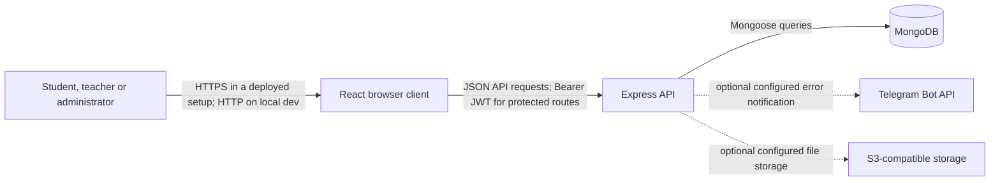

# Architecture and Threat Model

**Status:** checkpoint-2 working document
**Scope:** current repository snapshot on branch `main`
**Method:** asset and trust-boundary review with STRIDE-style threat identification
**Important limitation:** academic records now have a backend API, but attendance, requests, inbox, and student-file APIs remain placeholders.

## 1. Project concept

The project is a web-based university portal prototype. It is intended to let university users access academic and administrative services through role-protected accounts. The current implementation demonstrates login, a student dashboard, transcript data from the grades API, password changes, administrator user management, and academic-record management. Other academic pages are placeholders or use local sample data.

## 2. Team responsibilities

- **Student 1 - Backend and application security:** database and API, identity management, roles, password handling, and server-side authorization.
- **Student 2 - DevSecOps:** GitHub workflow, CI and security checks, safe local setup, and developer/review guide.
- **Student 3 - Frontend and threat modeling:** user-facing pages, architecture diagram, threat model, and authorization scenarios.

The roster uses the role labels supplied by the team; member names can be added when confirmed.

## 3. Current architecture

### Components

- **Browser client:** React 19, TypeScript, Ant Design, and React Router. Vite serves the development UI. The client calls the API using `VITE_API_URL`, defaulting to `http://localhost:5001/api`.
- **API server:** Node.js and Express. It validates selected request bodies and query parameters with Zod, applies Passport JWT authentication to protected routes, and uses role middleware for administrator and teacher routes.
- **Database:** MongoDB accessed through Mongoose. Current models are users, generic products, courses, and grades.
- **Optional object storage:** S3-compatible storage helper configured by environment variables. No current user-facing route was found that demonstrates its use.
- **Optional error notification:** the API can send production error details to a configured Telegram chat. This is a sensitive external data flow and must be limited and reviewed.

### Data-flow diagram

### Authentication flow

1. The browser sends username and password to `POST /api/users/login`.
2. The API validates the request, loads the user from MongoDB, and verifies the stored scrypt password hash.
3. On success, the API returns a signed JWT and public user fields.
4. The browser stores the JWT in `sessionStorage` or `localStorage`, depending on Remember me.
5. Protected API requests send the JWT as a Bearer token. Passport validates the token and checks the user's token version and active record.
6. Administrator routes additionally check the user's role. Logout increments token version, invalidating previously issued tokens.

### Academic records flow

1. An administrator creates courses and assigns an optional teacher account.
2. An administrator assigns a grade to a student, course, and semester.
3. A student calls `GET /api/grades/me`; the API derives the student identity from the JWT and returns only that student's records.
4. A teacher calls `GET /api/grades/teacher`; the API returns only grades for courses where the course's `teacher` field matches the authenticated teacher.
5. `GET /api/grades/:id` permits an administrator, the owning student, or the assigned teacher. Other callers receive `404` so the API does not reveal whether the record exists.
6. Course and grade creation, updates, and deletion remain administrator-only. Teacher grade submission is not implemented.

## 4. Data assets and trust boundaries

| Asset | Current location | Security need |
|---|---|---|
| Password hashes and account records | MongoDB | Confidentiality, integrity, and restricted administrator access |
| JWT signing secret | Backend environment | Confidentiality and integrity |
| JWT access token | Browser storage and API requests | Confidentiality and integrity; protect against theft and replay |
| Student profile and academic records | User, Course, and Grade models are implemented | Confidentiality, integrity, and record-level authorization; students must never read another student's grades |
| Temporary administrator/student passwords | Seed command output or one-time API response | Confidentiality and short-lived use |
| S3 credentials and stored files | Environment and optional S3-compatible service | Confidentiality, integrity, and access control |
| Operational error details | Server logs and optional Telegram notification | Minimize sensitive content and restrict access |

Trust boundaries exist between the user's browser and API, the API and MongoDB, and the API and optional third-party services (Telegram and S3). Production transport security, network restrictions, and deployment configuration are not present in this repository.

## 5. Threats and current mitigations

| ID | Threat / STRIDE category | Risk | Existing mitigation | Gap and required action |
|---|---|---|---|---|
| T1 | Stolen or guessed credentials (Spoofing) | High | Passwords are stored as salted scrypt hashes; login returns a generic invalid-credentials message. | No login throttling or lockout was found. Add rate limiting and monitor repeated failures. |
| T2 | Theft or replay of a valid JWT (Spoofing / Information disclosure) | High | JWT has an expiry; token version supports revocation on logout and password change. | Browser storage is accessible to injected JavaScript. Reduce XSS exposure, consider an HttpOnly secure cookie design, and use HTTPS in deployment. |
| T3 | Student accesses another student's grades (Information disclosure / Elevation of privilege) | High | `/api/grades/me` derives the student from the authenticated JWT; `/api/grades/:id` verifies ownership; teacher access is limited to assigned courses. Negative authorization tests cover student-to-student and teacher-to-other-course access. | Do not treat UI hiding as protection. Add equivalent ownership checks to attendance, requests, and file APIs before those records exist. |
| T4 | Student or teacher performs administrator actions (Elevation of privilege) | High | User-management and grade-management routes use `requireAdmin`. The teacher grade endpoint is read-only and filtered to courses assigned to the authenticated teacher. | The role enum includes Student, Teacher, Admin, Staff, and User. Teacher grade submission is not implemented; keep it read-only until an audit trail and least-privilege policy are added. Audit admin role/status and grade changes. |
| T5 | Unauthorized access to products or private academic data (Information disclosure) | Medium | Create, update, and delete product routes require an administrator; course listing requires authentication; grade routes enforce role and record ownership. | Product listing route is currently public. Confirm whether products are intended to be public; protect it if data is private. |
| T6 | Malformed input causes data corruption or unexpected behavior (Tampering) | Medium | Zod validators cover login, user-management, product, course, and grade inputs. Multer is on 2.4.x and the upload helper sets finite file and field limits. | Review all route schemas and add boundary tests. The Express JSON body limit is 50 MB, which is unnecessarily high for ordinary API JSON. |
| T7 | Secret committed to Git or exposed to frontend (Information disclosure) | High | Root ignore rules exclude `.env`; `.env.example` is present; production checks require a 32-byte JWT secret. | Gitleaks passed on the first GitHub run. The development sample key is intentionally weak and must never be used in production. Rotate any credential found in history. |
| T8 | Sensitive information leaked in logs or error responses (Information disclosure / Repudiation) | Medium | Production error responses hide generic internal errors; optional Telegram alerts are disabled unless configured. | Telegram receives error stack details when configured. Review redaction and access; add structured audit events for login and admin actions without logging credentials or tokens. |
| T9 | Denial of service through repeated requests or large payloads (Denial of service) | Medium | JSON parsing has a size cap. Multer limits uploads to 20 MB per file, 5 files, 30 fields, and bounded nesting/index values. | No API rate limiting was found; the current 50 MB JSON body limit is high. Add route-sensitive rate limits and lower JSON payload limits. |
| T10 | API traffic intercepted or modified in deployment (Tampering / Information disclosure) | High in production | CORS has an origin allowlist configurable through `CORS_ORIGIN`. | CORS is not transport encryption. No HTTPS termination, security headers, or deployment configuration is in this repository. Require HTTPS at the deployment edge and add appropriate security headers. |
| T11 | Dependency compromise or known vulnerable package (Tampering / Elevation of privilege) | Medium | Dependencies are pinned through committed npm lockfiles. | The first remote audit found fixable frontend dependency advisories; the frontend lockfile has been refreshed and the latest local audit reports zero vulnerabilities. On PR head `d9d5e17`, the push audit passed but the pull_request frontend audit failed; inspect/rerun that job before claiming the remote gate is clean. Dependabot checks weekly and waits seven days before proposing new package versions. |

### SAST finding triage

- Route and model modules are loaded through explicit `require` paths. Runtime filesystem entries can no longer select backend code.
- The API currently authenticates requests with an explicit `Authorization: Bearer` JWT and does not use browser cookies. Cross-site requests do not automatically attach this token, so cookie-based CSRF middleware is not applicable to the current flow. If authentication moves to cookies, add CSRF protection and cookie `SameSite`/`Secure` settings before release.
- Dependabot uses a seven-day cooldown to reduce exposure to newly published or unstable package versions.

Risk ratings are initial qualitative priorities for this project and should be revisited after implementation and review.

## 6. Security requirements derived from the model

1. Authentication must be enforced by the API for every private resource.
2. Authorization must be enforced on the server for both role and record ownership. A client-supplied student ID must not grant access to that student's data.
3. The API must reject invalid inputs and return generic client errors for internal failures.
4. Passwords, access tokens, signing keys, and real student data must never enter source control or logs.
5. Production traffic must use HTTPS, and production secrets must be unique and strong.
6. CI must block pull requests on required build, test, and security checks.
7. Authentication and administrator actions should be auditable without recording passwords, tokens, or sensitive academic values.
8. Academic records now have backend models/routes, per-record authorization, and allowed/denied tests. Apply the same pattern to attendance, requests, and files before those records are added.

## 7. Known scope gaps

- The backend defines Student, Teacher, Admin, Staff, and User roles. Teacher access is currently read-only and limited to grades for assigned courses; teacher grade submission is not implemented.
- Courses and grades now have backend APIs. Attendance, requests, inbox, and student-file APIs are still absent.
- The transcript page reads `/api/grades/me`, which demonstrates server-side grade privacy. The profile page reads `/api/users/me`.
- Requests, attendance, inbox, and student-files screens remain placeholders or use local sample data.
- CI runs backend unit tests, frontend lint/build, dependency audits, Semgrep SAST, and Gitleaks secret scanning. After feature-branch pushes were removed as a separate trigger, all six PR checks passed on `469746e`. GitHub's review API showed approval by `eskendir2006` on that head. `main` requires a pull request, one approval, an up-to-date branch, and all six checks, and dismisses stale approvals. The team chose local demonstration for now; production deployment and runtime controls are absent.
